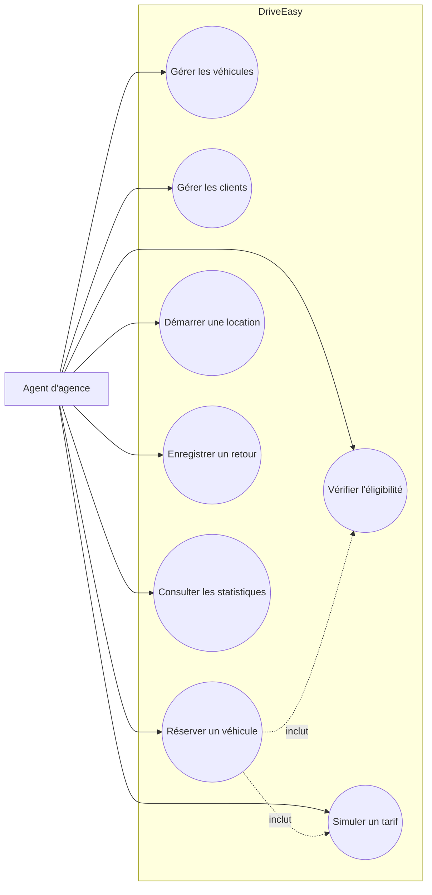
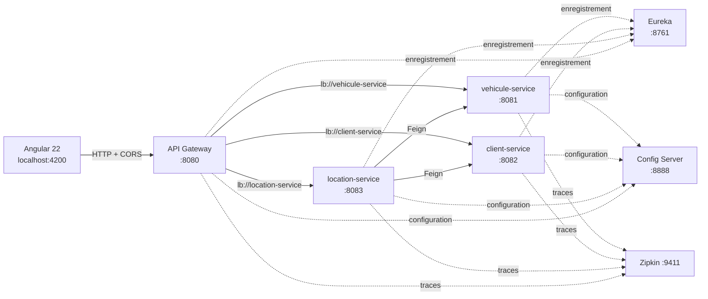
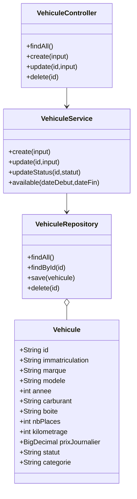
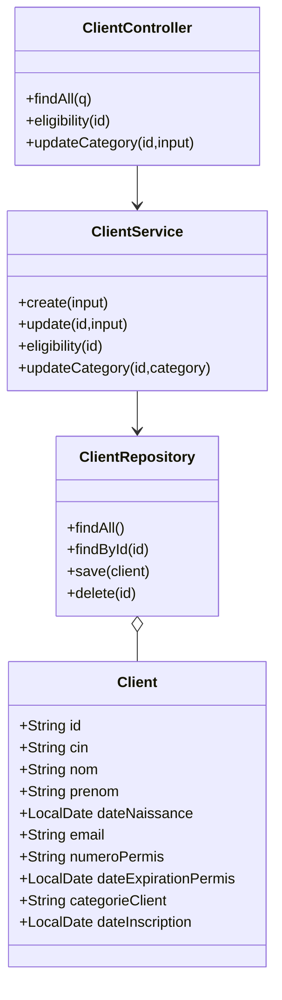
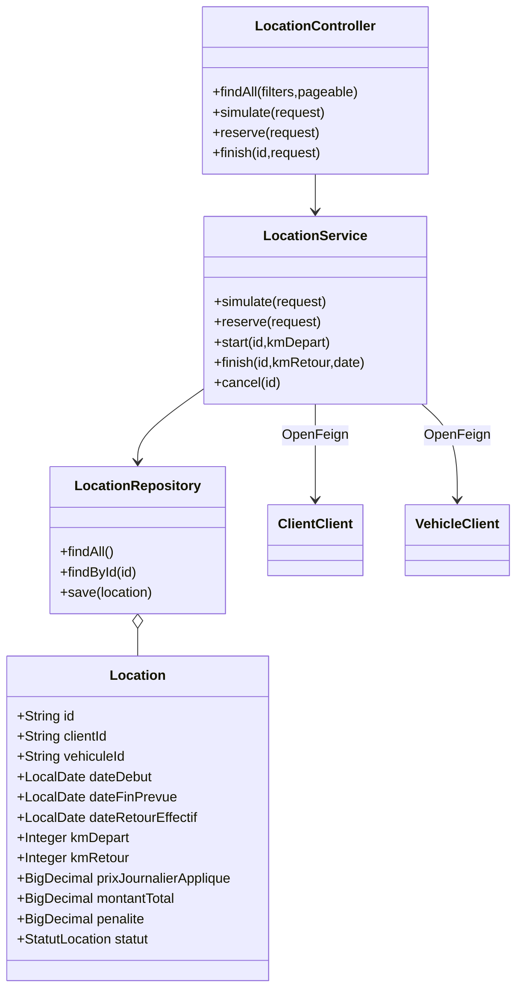
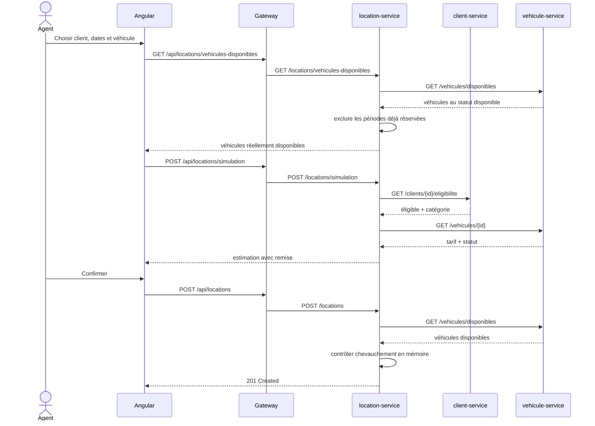

# Rapport de projet — DriveEasy

> **À personnaliser avant remise** : remplacer les éléments entre crochets, ajouter les captures réalisées sur une exécution locale et exporter ce document en PDF.

## Page de garde

- **Projet :** DriveEasy — Plateforme de location de véhicules
- **Étudiant(e) :** [Nom et prénom]
- **Formation :** Licence Informatique et Multimédia — LIM3 B/C
- **Année universitaire :** 2026–2027
- **Encadrant :** Karim Ben Romdhane
- **Dépôts :** [URL driveeasy-backend] · [URL driveeasy-frontend]

## Sommaire

1. Introduction et contexte
2. Analyse et conception
3. Architecture globale
4. Réalisation backend
5. Réalisation frontend (bonus)
6. Tests, démonstration et limites
7. Conclusion et perspectives
8. Annexes et webographie

### Liste des figures

1. Tableau de bord Eureka — à capturer
2. Simulation/création de réservation — à capturer
3. Tableau de bord Angular — à capturer
4. Catalogue des véhicules — à capturer
5. Fiche client — à capturer
6. Assistant de réservation — à capturer
7. Écran de retour — à capturer
8. Trace distribuée Zipkin — à capturer

### Liste des tableaux

1. Ports des composants (section 3)
2. Scénarios de démonstration (section 6)

## 1. Introduction et contexte

DriveEasy répond au besoin d'une agence de location souhaitant gérer son parc, ses clients et le cycle complet d'une location. Le prototype sépare ces responsabilités en services indépendants exposés par HTTP. La plateforme automatise l'éligibilité documentaire, la disponibilité, les remises fidélité et les pénalités de retard.

**Périmètre livré :** registry Eureka, configuration Spring Cloud Config stockée dans un dépôt Git local, trois microservices Spring Boot sans base de données, API Gateway, Zipkin et interface Angular standalone. Les processus métier et l'état sont volatils et sont réinitialisés au redémarrage.

## 2. Analyse et conception

### Acteurs et cas d'utilisation



### Règles métier

- Immatriculation, CIN, email et permis sont uniques.
- Un véhicule ne peut être réservé s'il n'est pas disponible ou si une réservation locale chevauche la période demandée.
- Le client doit être âgé d'au moins 21 ans et son permis doit être valide.
- La remise est de 5 % pour `FIDELE` et 10 % pour `VIP`; le passage aux catégories supérieures est piloté par les locations terminées (seuils 5 et 15).
- Une pénalité de retard égale à 1,5 fois le tarif journalier est ajoutée pour chaque jour de dépassement.
- Les données restent en RAM : ce prototype ne garantit pas de cohérence inter-instance ni de persistance après arrêt.

## 3. Architecture globale



Le démarrage recommandé est Eureka, Config Server, services métier, Gateway puis Angular. Zipkin peut démarrer à tout moment. Actuator expose `health` et `info`; le sampling Zipkin est configuré à `1.0` en développement. Aucun composant de base de données n'est lancé, conformément à l'interdiction de persistance dans le cahier des charges.

### Installation et préparation d'une machine vierge

1. Installer un JDK 21 (Temurin ou distribution équivalente), puis vérifier `java -version` et `javac -version`.
2. Installer Maven 3.9 ou supérieur, configurer `MAVEN_HOME`/`PATH`, puis vérifier `mvn -version`.
3. Installer Node.js compatible Angular 22 depuis nodejs.org; vérifier `node --version` et `npm --version`.
4. Installer et démarrer Docker Desktop; vérifier `docker version` et `docker compose version`.
5. Cloner les deux dépôts, démarrer Zipkin et suivre l'ordre des services indiqué dans le README backend.

## 4. Réalisation backend

### Service Registry — port 8761

Eureka Server permet l'enregistrement et la découverte dynamique. Il ne s'enregistre pas lui-même (`register-with-eureka=false`, `fetch-registry=false`).  
**Capture à insérer — Figure 1 :** tableau de bord Eureka montrant `API-GATEWAY`, `VEHICULE-SERVICE`, `CLIENT-SERVICE` et `LOCATION-SERVICE` en état `UP`.  
**Analyse :** la présence des instances confirme la résolution dynamique `lb://` et supprime le besoin d'adresses IP fixes.

### Config Server — port 8888

Le serveur lit `config-repo` via une URI Git locale (`file:../config-repo`). Les fichiers globaux et propres à chaque application contiennent ports, paramètres Eureka/Zipkin et propriétés métier. Le script `scripts/init-config-repo.cmd` initialise le dépôt versionné pour le premier lancement.

### Microservices

#### Modèle véhicule



#### Modèle client



#### Modèle location



Tous les services métier utilisent des contrôleurs REST, des services applicatifs, des repositories `ConcurrentHashMap`, des DTOs validés et une réponse d'erreur cohérente (`400`, `404`, `409`, `500`). Les créations retournent `201`, les suppressions `204`. Les appels Feign nécessaires à la réservation et au retour sont contrôlés; la libération du véhicule est compensée si une mise à jour distante échoue.

### Création d'une réservation



**Capture à insérer — Figure 2 :** requête de simulation et création dans Postman/Insomnia.  
**Analyse :** relever le statut HTTP, la durée de réponse et vérifier l'absence de création lors d'une simulation.

## 5. Réalisation frontend (bonus)

L'application est composée de standalone components et utilise Signals pour l'état d'affichage. `provideRouter` déclare les routes demandées; `provideHttpClient` installe l'intercepteur d'erreurs. Les services TypeScript centralisent les appels vers la Gateway. Le formulaire véhicule permet aussi de modifier son statut; la fiche client présente son éligibilité et son historique. Le parcours de réservation comporte quatre étapes : client et éligibilité, dates et véhicule réellement disponible, simulation, confirmation. Le retour affiche la saisie kilométrique, le montant final et la pénalité.

**Captures à insérer :**

- **Figure 3 — Tableau de bord :** indicateurs de flotte et chiffre d'affaires; analyser les valeurs fournies par les APIs.
- **Figure 4 — Catalogue :** véhicules et filtre appliqué; vérifier que le statut correspond au service métier.
- **Figure 5 — Fiche client :** catégorie et validité du permis; commenter l'éligibilité calculée.
- **Figure 6 — Assistant de réservation :** une capture de chacune des quatre étapes; rapprocher le devis de la règle de remise.
- **Figure 7 — Retour :** kilométrage, total final et pénalité; contrôler le statut `TERMINEE`.

## 6. Tests, démonstration et limites

Les scénarios de démonstration à exécuter sont : création véhicule et conflit d'immatriculation; client mineur/permis expiré; simulation STANDARD/FIDELE/VIP; réservation de périodes superposées; départ, retour à l'heure et retour tardif; consultation Zipkin. Compléter ce tableau à partir des résultats réellement observés :

| Scénario | Résultat observé | Capture |
|---|---|---|
| Vérifier les instances Eureka | [À renseigner] | Figure 1 |
| Créer une réservation via Gateway | [À renseigner] | Figure 2 |
| Visualiser la trace inter-services | [À renseigner] | Figure 8 |

**Capture à insérer — Figure 8 :** trace Zipkin filtrée sur une réservation, avec Gateway, location-service et services appelés.  
**Analyse :** commenter la durée globale et les segments Feign; expliquer les éventuels temps d'attente et erreurs.

**Limites :** la persistance et la cohérence distribuée complète ne sont pas couvertes. Le verrou contre les réservations concurrentes est limité à une instance de `location-service`. Les images sont des URL distantes et les données de démonstration sont statiques.

## 7. Conclusion et perspectives

Le projet sépare la gestion du parc, de la clientèle et des locations et centralise l'entrée HTTP et la configuration. Les améliorations prioritaires sont un stockage durable si le périmètre l'autorise, une réservation idempotente et atomique, une authentification, un contrôle d'accès par rôle, des tests d'intégration automatisés et des tableaux de bord de métriques.

## 8. Annexes et webographie

- Dépôt backend : [URL à compléter]
- Dépôt frontend : [URL à compléter]
- Documentation Spring Boot : https://docs.spring.io/spring-boot/
- Spring Cloud Config : https://docs.spring.io/spring-cloud-config/
- Spring Cloud Netflix : https://docs.spring.io/spring-cloud-netflix/
- Angular : https://angular.dev/
- Zipkin : https://zipkin.io/

### Exemples de contrôle des captures

Les captures doivent être créées localement après démarrage de l'ensemble des services; aucun écran simulé ne remplace une preuve d'exécution. Ajouter les fichiers dans `docs/captures/`, masquer les données personnelles et renseigner les figures avec les valeurs réellement affichées.

### Extraits de configuration et métier

La configuration globale expose uniquement les contrôles de santé et d'information et active l'échantillonnage intégral pour faciliter l'analyse en développement :

```yaml
management:
  endpoints:
    web:
      exposure:
        include: health,info
  tracing:
    sampling:
      probability: 1.0
```

Le calcul de fidélité applique une remise directe au tarif avant ajout de la pénalité :

```java
BigDecimal remise = switch (categorieClient) {
    case "FIDELE" -> new BigDecimal("0.05");
    case "VIP" -> new BigDecimal("0.10");
    default -> BigDecimal.ZERO;
};
BigDecimal tarifNet = prixJournalier.multiply(BigDecimal.ONE.subtract(remise));
BigDecimal penalite = prixJournalier.multiply(new BigDecimal("1.5"))
        .multiply(BigDecimal.valueOf(joursDeRetard));
```
