# Rapport de projet — DriveEasy

## Page de garde

- **Projet :** DriveEasy — Plateforme de location de véhicules
- **Étudiant :** Yassin Guesmi
- **Formation :** Licence Informatique et Multimédia — LIM3 B/C
- **Année universitaire :** 2026–2027
- **Encadrant :** Karim Ben Romdhane
- **Dépôt :** https://github.com/yassinguesmi-dot/drive-easy (dossiers `driveeasy-backend` et `driveeasy-frontend`)
- **Date de remise :** 26 novembre 2026

## Sommaire

1. Introduction et contexte
2. Analyse et conception
3. Architecture globale
4. Réalisation backend
5. Réalisation frontend (bonus)
6. Tests, démonstration et limites
7. Conclusion et perspectives
8. Annexes et webographie

### Liste des figures

1. Tableau de bord Eureka (section 4)
2. Détail d'une réservation lu via l'API Gateway (section 4)
3. Tableau de bord Angular (section 5)
4. Catalogue des véhicules (section 5)
5. Fiche client et éligibilité (section 5)
6. Assistant de réservation, étapes 1 à 4 et liste mise à jour (section 5)
7. Écran de retour : saisie puis clôture (section 5)
8. Trace distribuée Zipkin d'une réservation (section 6)

### Liste des tableaux

1. Ports des composants (section 3)
2. Tests automatisés (section 6)
3. Scénarios de démonstration et résultats observés (section 6)
4. Anomalies détectées et corrigées pendant la validation (section 6)

## 1. Introduction et contexte

DriveEasy répond au besoin d'une agence de location souhaitant gérer son parc, ses clients et le cycle complet d'une location. Le prototype sépare ces responsabilités en services indépendants exposés par HTTP. La plateforme automatise l'éligibilité documentaire, la disponibilité, les remises fidélité et les pénalités de retard.

**Périmètre livré :** registry Eureka, configuration Spring Cloud Config stockée dans un dépôt Git local, trois microservices Spring Boot sans base de données, API Gateway, Zipkin et interface Angular standalone. Les processus métier et l'état sont volatils et sont réinitialisés au redémarrage.

## 2. Analyse et conception

### Acteurs et cas d'utilisation

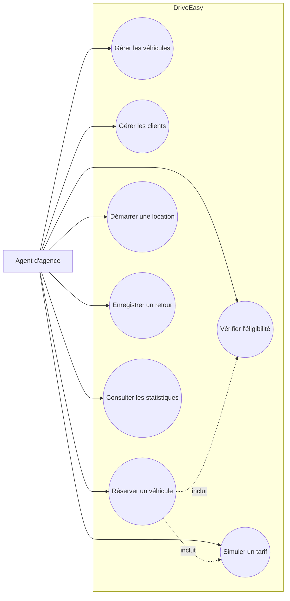

### Règles métier

- Immatriculation, CIN, email et permis sont uniques.
- Un véhicule ne peut être réservé s'il n'est pas disponible ou si une réservation locale chevauche la période demandée.
- Le client doit être âgé d'au moins 21 ans et son permis doit être valide.
- La remise est de 5 % pour `FIDELE` et 10 % pour `VIP`; le passage aux catégories supérieures est piloté par les locations terminées (seuils 5 et 15).
- Une pénalité de retard égale à 1,5 fois le tarif journalier est ajoutée pour chaque jour de dépassement.
- Les données restent en RAM : ce prototype ne garantit pas de cohérence inter-instance ni de persistance après arrêt.

## 3. Architecture globale

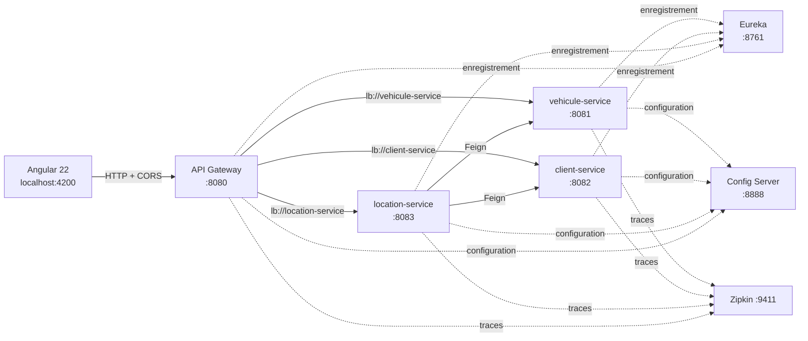

**Tableau 1 — Ports des composants**

| Composant | Port | Rôle |
|---|---:|---|
| `service-registry` (Eureka) | 8761 | Enregistrement et découverte des services |
| `config-server` | 8888 | Configuration centralisée lue dans `config-repo` (Git) |
| `vehicule-service` | 8081 | Parc automobile, statuts et kilométrage |
| `client-service` | 8082 | Clients, éligibilité et catégorie de fidélité |
| `location-service` | 8083 | Réservations, départs, retours, statistiques ; orchestration Feign |
| `api-gateway` | 8080 | Point d'entrée unique, CORS, routage `lb://`, journalisation |
| Zipkin (Docker) | 9411 | Collecte et visualisation des traces distribuées |
| Angular (`ng serve`) | 4200 | Interface agence et portail client |

Le démarrage recommandé est Eureka, Config Server, services métier, Gateway puis Angular. Zipkin peut démarrer à tout moment. Actuator expose `health` et `info`; le sampling Zipkin est configuré à `1.0` en développement. Aucun composant de base de données n'est lancé, conformément à l'interdiction de persistance dans le cahier des charges.

### Installation et préparation d'une machine vierge

1. Installer un JDK 21 (Temurin ou distribution équivalente), puis vérifier `java -version` et `javac -version`.
2. Installer Maven 3.9 ou supérieur, configurer `MAVEN_HOME`/`PATH`, puis vérifier `mvn -version`.
3. Installer Node.js compatible Angular 22 depuis nodejs.org; vérifier `node --version` et `npm --version`.
4. Installer et démarrer Docker Desktop; vérifier `docker version` et `docker compose version`.
5. Cloner le dépôt, exécuter `scripts\init-config-repo.cmd`, démarrer Zipkin (`docker compose up -d zipkin`) et suivre l'ordre des services indiqué dans le README backend.
6. Côté frontend : `npm install` puis `npm start` dans `driveeasy-frontend`, et ouvrir http://localhost:4200.

Après `mvn package`, chaque module produit un jar exécutable (`java -jar target/<module>-1.0.0.jar`) grâce à l'exécution `repackage` du plugin Spring Boot déclarée dans le pom parent. Juste après le démarrage, la Gateway peut répondre `503` pendant environ 30 secondes : c'est le temps nécessaire pour que les services s'enregistrent dans Eureka et que la Gateway rafraîchisse son cache.

## 4. Réalisation backend

### Service Registry — port 8761

Eureka Server permet l'enregistrement et la découverte dynamique. Il ne s'enregistre pas lui-même (`register-with-eureka=false`, `fetch-registry=false`).

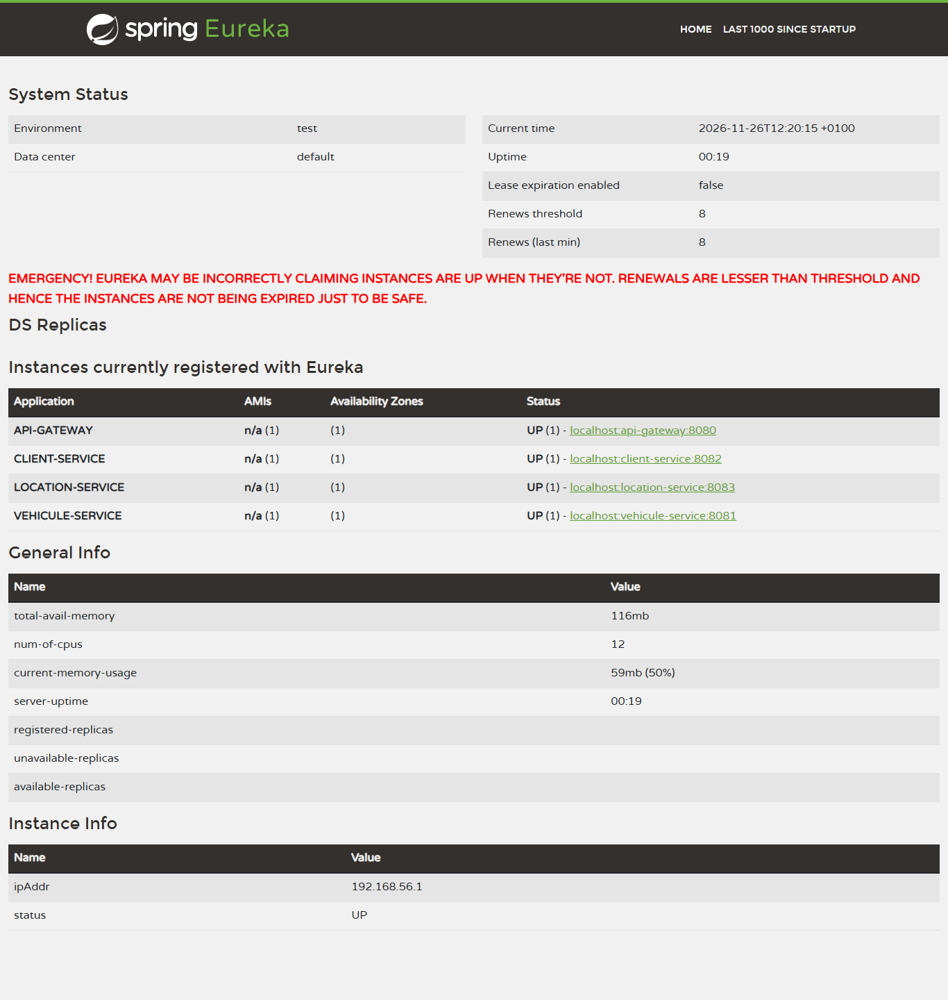

*Figure 1 — Tableau de bord Eureka après démarrage complet (26/11/2026).*

**Analyse :** les quatre applications `API-GATEWAY`, `CLIENT-SERVICE`, `LOCATION-SERVICE` et `VEHICULE-SERVICE` sont enregistrées avec une instance chacune, toutes au statut `UP`. La Gateway résout donc les routes `lb://` sans adresse IP codée en dur. Le bandeau rouge « EMERGENCY » est le mode d'auto-préservation d'Eureka : sur un poste de développement, le nombre de renouvellements reçus pendant la première minute reste sous le seuil attendu, et Eureka cesse alors d'expirer les instances par précaution. Ce message n'indique pas de panne ; en production, on garde ce mécanisme, et en développement on pourrait le désactiver avec `eureka.server.enable-self-preservation=false`.

### Config Server — port 8888

Le serveur lit `config-repo` via une URI Git locale (`file:../config-repo`). Les fichiers globaux et propres à chaque application contiennent ports, paramètres Eureka/Zipkin et propriétés métier. Le script `scripts/init-config-repo.cmd` initialise le dépôt versionné pour le premier lancement.

### Microservices

#### Modèle véhicule

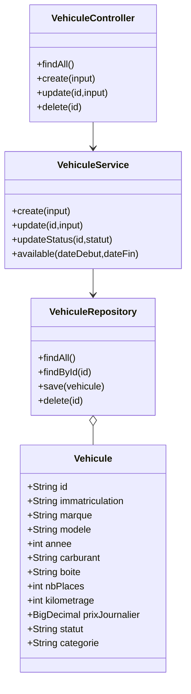

#### Modèle client

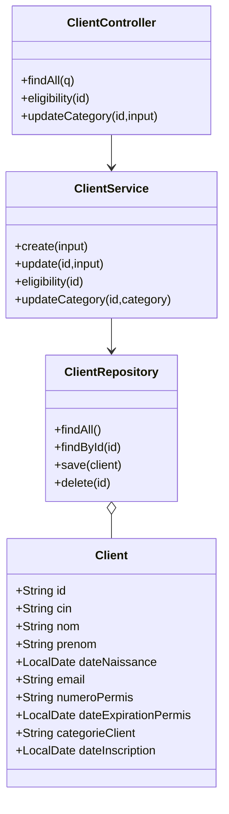

#### Modèle location

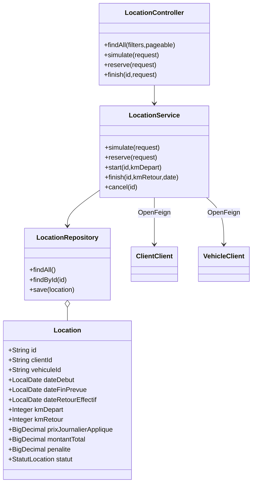

Tous les services métier utilisent des contrôleurs REST, des services applicatifs, des repositories `ConcurrentHashMap`, des DTOs validés et une réponse d'erreur cohérente (`400`, `404`, `409`, `500`). Les créations retournent `201`, les suppressions `204`. Les appels Feign nécessaires à la réservation et au retour sont contrôlés; la libération du véhicule est compensée si une mise à jour distante échoue. Un corps JSON mal formé est rejeté en `400` avec un message explicite.

Deux choix techniques conditionnent le bon fonctionnement de l'orchestration dans `location-service` :

- **Client HTTP Feign `feign-hc5` (Apache HttpClient 5)** : le client par défaut de Feign repose sur `HttpURLConnection`, qui refuse la méthode `PATCH`. Or le départ et le retour d'une location changent le statut du véhicule par `PATCH /vehicules/{id}/statut`. Sans ce module, ces opérations échouaient en `500`.
- **Instrumentation `feign-micrometer`** : elle ajoute les en-têtes de trace W3C aux appels Feign. Sans elle, les spans de `client-service` et `vehicule-service` apparaissaient dans Zipkin comme des traces isolées au lieu d'être rattachés à la requête d'origine. Les appels protégés par le circuit breaker Resilience4j s'exécutent en outre dans le thread de la requête (`spring.cloud.circuitbreaker.resilience4j.disable-thread-pool=true`).

### Création d'une réservation

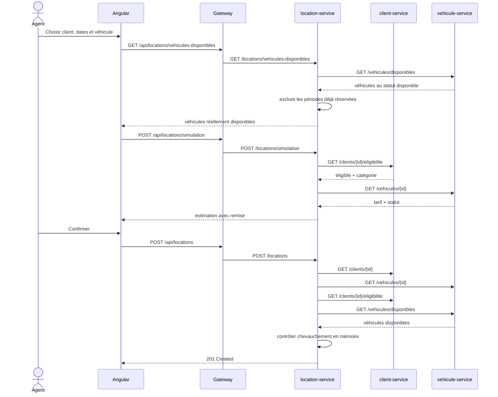

L'ordre des appels de la confirmation correspond à celui relevé dans la trace Zipkin de la figure 8.

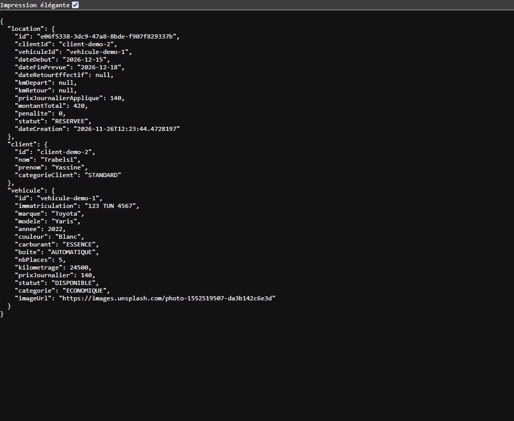

*Figure 2 — Réponse de `GET http://localhost:8080/api/locations/{id}` pour une réservation créée à l'instant.*

**Analyse :** la réservation a été créée par `POST /api/locations` (réponse `201 Created`), puis relue via la Gateway. La réponse agrège trois sources : la location elle-même (`location-service`), le résumé du client (`client-service`) et la fiche du véhicule (`vehicule-service`), obtenus par Feign. Le statut est `RESERVEE`, `kmDepart` et `dateRetourEffectif` restent `null` tant que le départ n'a pas eu lieu, et le montant (`420`) correspond à 3 jours × 140 € sans remise pour un client `STANDARD`. Les mesures `curl` relevées pendant les essais donnent entre 20 et 160 ms par requête via la Gateway. Une simulation (`POST /api/locations/simulation`, `200 OK`) ne crée aucune location : la liste comptait 5 contrats avant trois simulations successives et toujours 5 après.

## 5. Réalisation frontend (bonus)

L'application est composée de standalone components et utilise Signals pour l'état d'affichage. `provideRouter` déclare les routes demandées; `provideHttpClient` installe l'intercepteur d'erreurs. Les services TypeScript centralisent les appels vers la Gateway. Le formulaire véhicule permet aussi de modifier son statut; la fiche client présente son éligibilité et son historique. Le parcours de réservation comporte quatre étapes : client et éligibilité, dates et véhicule réellement disponible, simulation, confirmation. Le retour affiche la saisie kilométrique, le montant final et la pénalité.

Les captures ci-dessous ont été réalisées le 26/11/2026 sur l'application lancée localement (Angular sur le port 4200, tous les services démarrés), avec les données de démonstration recréées au démarrage.

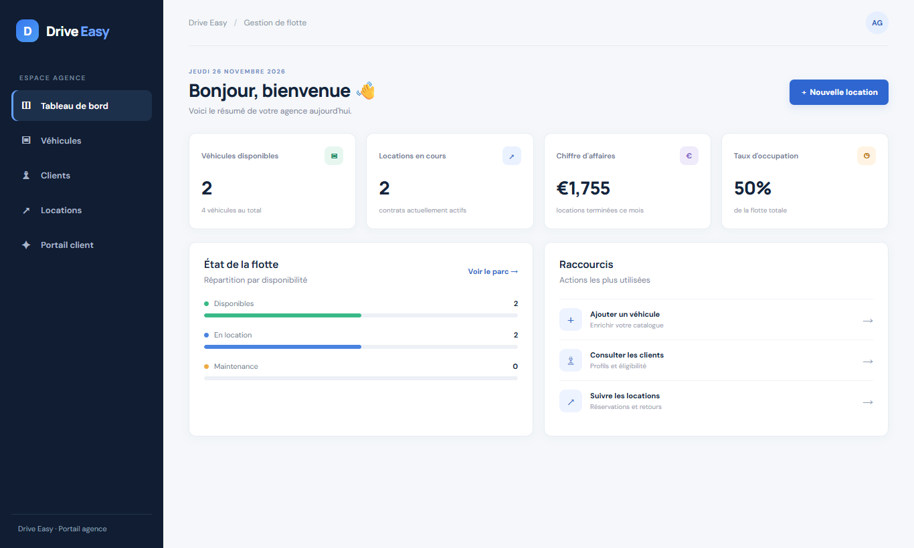

*Figure 3 — Tableau de bord de l'espace agence.*

**Analyse :** les indicateurs viennent directement des APIs : 4 véhicules au total dont 2 disponibles et 2 en location (`GET /api/vehicules`), 2 locations en cours (`GET /api/locations?statut=EN_COURS`), et un chiffre d'affaires de 1 755 € avec un taux d'occupation de 50 % (`GET /api/locations/statistiques`). Le taux est cohérent : 2 véhicules loués sur 4. Le chiffre d'affaires correspond à la somme des 4 locations terminées de démonstration (280 + 660 + 230 + 585). Si un service ne répond pas, la page passe en « mode démonstration » et l'indique par un bandeau, au lieu d'afficher des zéros trompeurs.

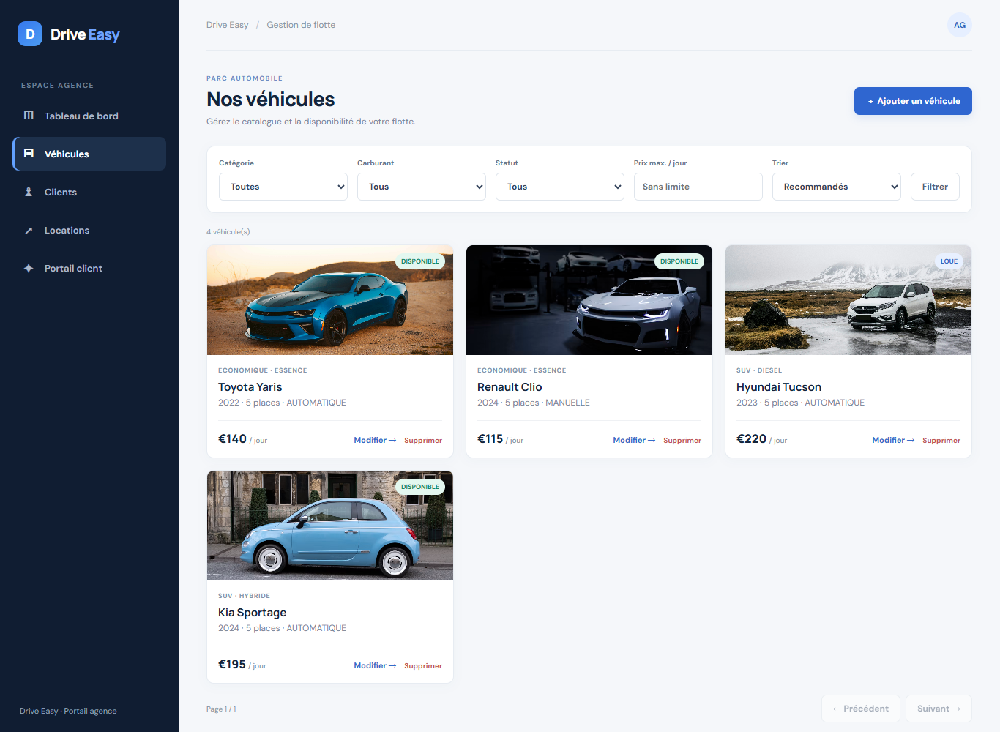

*Figure 4 — Catalogue des véhicules avec filtres.*

**Analyse :** les 4 véhicules du service `vehicule-service` sont affichés avec leur catégorie, leur carburant, leur tarif journalier et leur statut. Les badges `LOUE` de la Renault Clio et du Hyundai Tucson correspondent bien aux deux locations en cours : le statut est mis à jour par `location-service` au moment du départ. Les filtres (catégorie, carburant, statut, prix maximum) sont transmis en paramètres de requête au service. Les photographies sont des URL d'illustration et ne représentent pas le modèle exact (voir les limites, section 6).

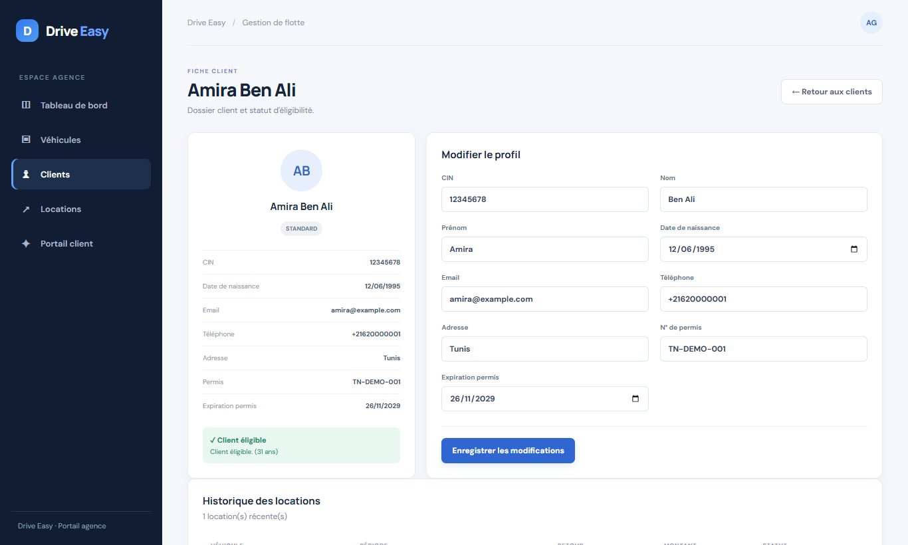

*Figure 5 — Fiche client avec éligibilité et formulaire de modification.*

**Analyse :** la fiche d'Amira Ben Ali (31 ans, permis valide jusqu'au 26/11/2029, catégorie `STANDARD`) affiche « Client éligible ». Ce résultat vient de `GET /api/clients/{id}/eligibilite`, qui contrôle les deux règles métier : âge d'au moins 21 ans et permis non expiré. Le formulaire permet de modifier le profil (`PUT /api/clients/{id}`), et l'historique en bas de page liste les locations du client.

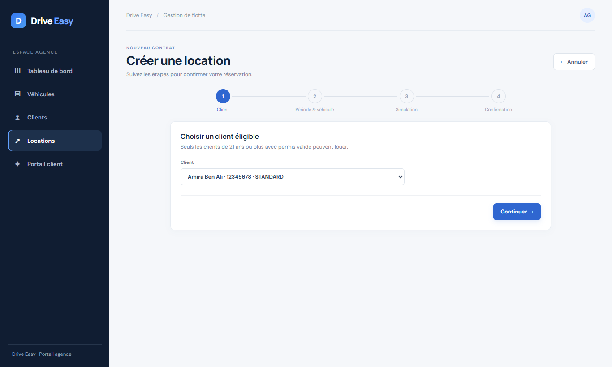

*Figure 6a — Étape 1 : choix d'un client.*

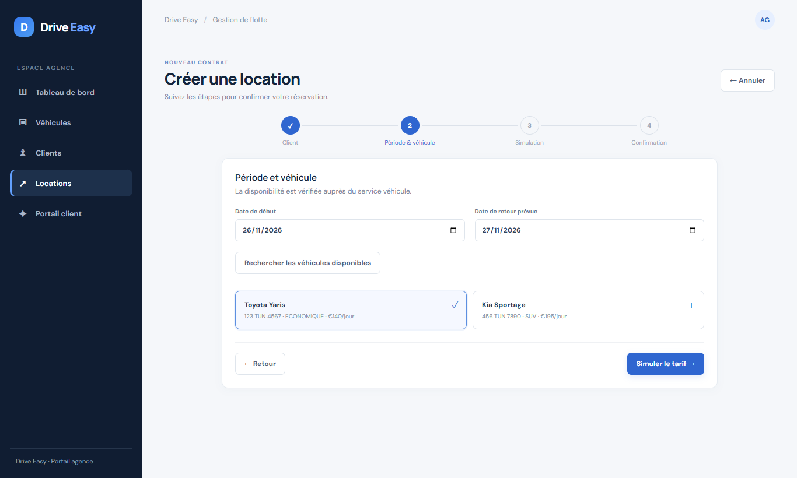

*Figure 6b — Étape 2 : période et véhicule réellement disponible.*

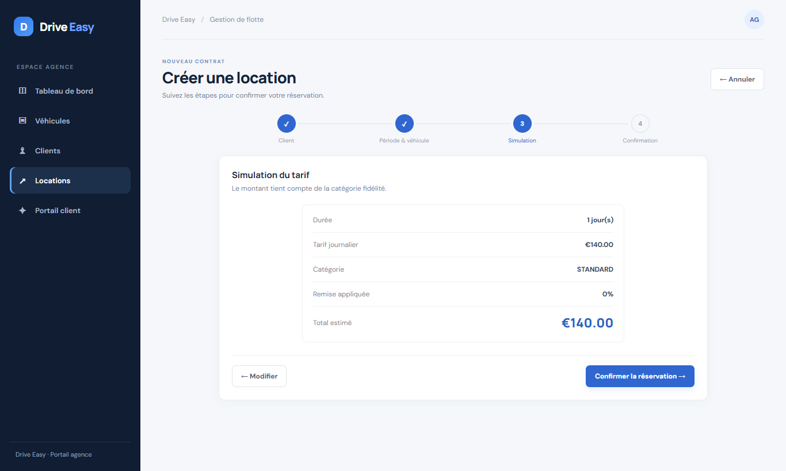

*Figure 6c — Étape 3 : simulation du tarif.*

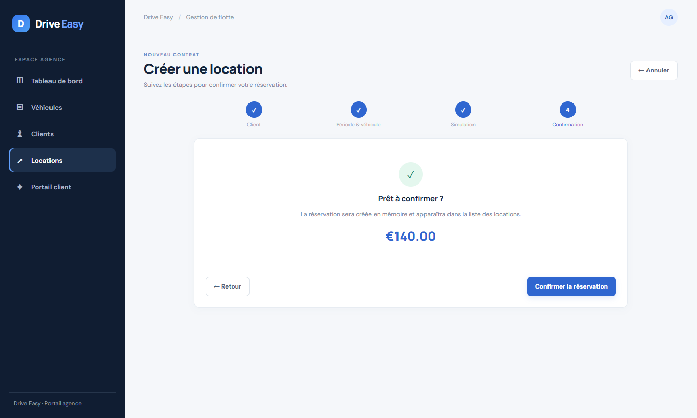

*Figure 6d — Étape 4 : confirmation.*

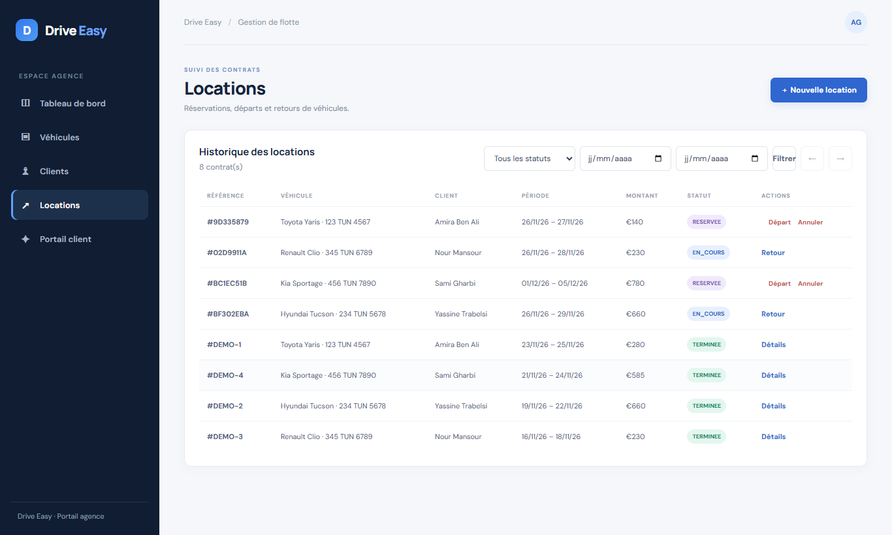

*Figure 6e — Liste des locations après confirmation : la nouvelle réservation apparaît en tête au statut `RESERVEE`.*

**Analyse :** à l'étape 1, le passage à l'étape suivante est conditionné par l'éligibilité du client. À l'étape 2, seuls 2 véhicules sur 4 sont proposés pour le 26/11 → 27/11 : la Clio et le Tucson, déjà loués, sont exclus. La simulation de l'étape 3 donne 1 jour × 140 € = 140 €, avec 0 % de remise, ce qui correspond à la règle pour un client `STANDARD` (5 % pour `FIDELE`, 10 % pour `VIP`, voir le tableau 3). La confirmation crée la réservation, qui s'affiche dans la liste avec le nom du véhicule, le nom du client et une référence courte.

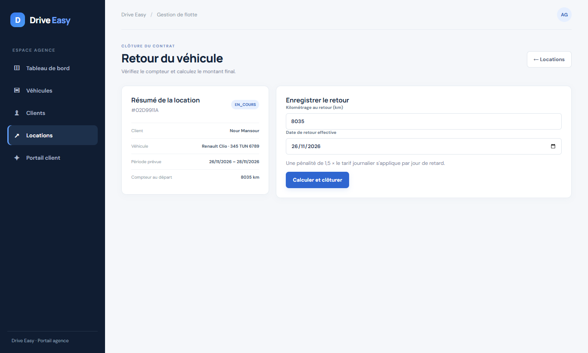

*Figure 7a — Saisie du retour d'une location en cours.*

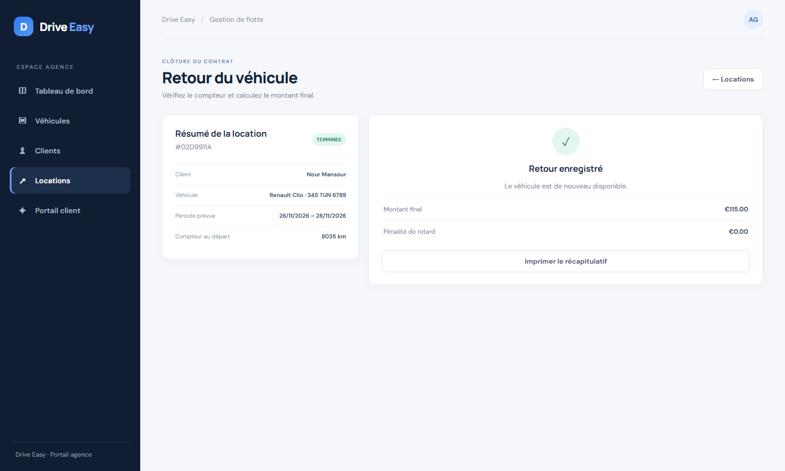

*Figure 7b — Retour enregistré : montant final et pénalité.*

**Analyse :** la location de la Renault Clio (départ à 8 035 km, retour prévu le 28/11) est rendue le jour même. Le kilométrage de retour est pré-rempli avec le plus grand des deux compteurs (départ ou véhicule), ce qui évite un refus de validation. Le montant final est de 115 € (1 jour × 115 €) et la pénalité de 0 €, puisque le retour a lieu avant la date prévue. Le statut passe à `TERMINEE` et le véhicule redevient `DISPONIBLE`. Le cas d'un retour tardif est vérifié par un test automatisé (section 6).

## 6. Tests, démonstration et limites

### Tests automatisés

**Tableau 2 — Tests automatisés**

| Module | Outil | Tests | Résultat |
|---|---|---|---|
| `client-service` | JUnit 5 | Création des 4 clients de démonstration et de leur nombre de locations terminées | 1/1 réussi |
| `location-service` | JUnit 5 + Mockito | Données de démonstration ; exclusion des véhicules déjà réservés ; prise en compte des réservations annulées ; pénalité de retour tardif | 4/4 réussis |
| `driveeasy-frontend` | Vitest | Suppression d'un véhicule et d'un client après confirmation ; aucune suppression si l'utilisateur annule | 3/3 réussis |

Commandes : `mvn test` depuis `driveeasy-backend`, `npm test` depuis `driveeasy-frontend`. La compilation de production (`ng build`) se termine sans erreur ni avertissement.

Le test `lateReturnAddsPenaltyOfOneAndHalfDailyRatePerLateDay` couvre le retour tardif, qu'on ne peut pas reproduire en direct : l'API refuse, à juste titre, une date de retour postérieure à aujourd'hui. Le cas testé est une location à 100 €/jour, démarrée il y a 5 jours, dont le retour était prévu il y a 3 jours, et rendue aujourd'hui. Le test vérifie une pénalité de 3 × 1,5 × 100 = 450 € et un total de 5 × 100 + 450 = 950 €, avec le statut `TERMINEE`.

### Scénarios de démonstration

Tous les scénarios ont été exécutés le 26/11/2026 à travers l'API Gateway (`http://localhost:8080/api`). Les durées sont celles mesurées par `curl`.

**Tableau 3 — Scénarios de démonstration et résultats observés**

| Scénario | Requête | Résultat observé | Preuve |
|---|---|---|---|
| Instances enregistrées | Console Eureka | 4 applications `UP` (Gateway et 3 services métier) | Figure 1 |
| Création d'un véhicule | `POST /vehicules` (nouvelle immatriculation) | `201 Created`, statut `DISPONIBLE`, 23 ms | — |
| Conflit d'immatriculation | `POST /vehicules` avec « 123 TUN 4567 » | `409 Conflict` : « Immatriculation déjà utilisée », 97 ms | — |
| Client mineur | `GET /clients/{id}/eligibilite` (né en 2010) | `200`, `eligible=false`, âge 16, « au moins 21 ans » | — |
| Permis expiré | `GET /clients/{id}/eligibilite` (expiré en 2024) | `200`, `eligible=false`, `permisValide=false` | — |
| Réservation d'un client non éligible | `POST /locations` | `409` : « Le client n'est pas éligible à la location » | — |
| Simulation `STANDARD` | 4 jours de Tucson à 220 € | remise 0 %, montant 880 € | Figure 6c (cas 1 jour) |
| Simulation `FIDELE` | idem | remise 5 %, montant 836 € | — |
| Simulation `VIP` | idem | remise 10 %, montant 792 € | — |
| Réservation | `POST /locations` (Kia Sportage, 01/12 → 05/12) | `201`, `RESERVEE`, 780 € (4 × 195) | Figures 2, 6e |
| Réservation qui chevauche | même véhicule, 03/12 → 07/12 | `409` : « Le véhicule a déjà une réservation sur cette période » | — |
| Départ | `PATCH /locations/{id}/depart` | `200`, `EN_COURS` ; le véhicule passe à `LOUE` | Figure 4 |
| Retour à l'heure | `PATCH /locations/{id}/retour` | `200`, `TERMINEE`, pénalité 0 € ; véhicule `DISPONIBLE` | Figure 7b |
| Retour tardif | test unitaire | pénalité 450 €, total 950 € | Tableau 2 |
| Date de retour future | `PATCH /locations/{id}/retour` au 29/11 | `400` : date hors de l'intervalle autorisé | — |
| JSON mal formé | `POST /clients` avec un corps tronqué | `400` : « Corps de requête JSON invalide ou mal formé » | — |
| Trace inter-services | Zipkin | 1 trace, 4 services, 15 spans, 242 ms | Figure 8 |

### Traçabilité distribuée

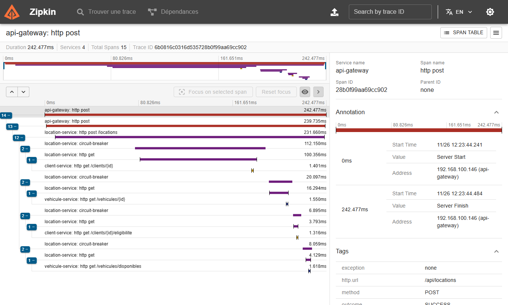

*Figure 8 — Trace Zipkin de la confirmation d'une réservation (`POST /api/locations`).*

**Analyse :** la trace relie 15 spans répartis sur 4 services (`api-gateway`, `location-service`, `client-service`, `vehicule-service`), pour une durée totale de 242 ms. Le traitement côté `location-service` dure 232 ms. Les appels Feign apparaissent dans l'ordre : client (`GET /clients/{id}`), véhicule (`GET /vehicules/{id}`), éligibilité, puis véhicules disponibles. Côté serveur, chaque appel ne prend que 1,3 à 1,6 ms. L'essentiel du temps se trouve dans le premier span client `http get` (100 ms) : c'est le premier appel après le redémarrage du service, qui inclut l'ouverture des connexions HTTP et le chargement de l'équilibreur de charge. Les appels suivants ne coûtent que 4 à 16 ms. Le circuit breaker ajoute environ 3 à 12 ms autour de chaque appel. Aucune erreur n'apparaît dans la trace (`outcome=SUCCESS`).

### Anomalies détectées et corrigées pendant la validation

L'exécution complète des scénarios a mis en évidence plusieurs défauts. Ils ont été corrigés avant la rédaction de ce rapport.

**Tableau 4 — Anomalies détectées et corrigées**

| Anomalie | Cause | Correction |
|---|---|---|
| Départ et retour en `500` | Le client Feign par défaut (`HttpURLConnection`) ne supporte pas `PATCH` | Ajout de `feign-hc5` |
| Jars non exécutables (« aucun attribut manifest principal ») | Goal `repackage` absent du pom parent | Exécution `repackage` déclarée dans `pluginManagement` |
| Trace Zipkin coupée entre services | Feign non instrumenté : aucun en-tête de trace propagé | Ajout de `feign-micrometer` ; circuit breaker dans le thread appelant |
| JSON mal formé renvoyé en `500` | `HttpMessageNotReadableException` non gérée | Gestionnaire `400` dans les trois services |
| Message « Failed to fetch » en anglais | L'intercepteur affichait le message brut du navigateur | Message français pour les erreurs réseau |
| Retour bloqué sans message visible | Km retour pré-rempli sous le km de départ | Pré-remplissage au maximum des deux compteurs |
| « Détails » d'une location terminée inutilisable | Formulaire de retour désactivé au lieu du récapitulatif | Affichage du récapitulatif pour le statut `TERMINEE` |
| Identifiants techniques dans la liste des locations | Affichage brut de `clientId` et `vehiculeId` | Nom du client, modèle et immatriculation du véhicule |
| Date du jour décalée entre minuit et 1 h | Dates calculées en UTC (`toISOString`) | Calcul en heure locale |

### Limites

- **Persistance :** les données sont en mémoire (contrainte du cahier des charges) et sont recréées à chaque redémarrage. La cohérence distribuée complète n'est pas couverte : les mises à jour inter-services sont compensées en cas d'échec, mais elles ne sont pas transactionnelles.
- **Concurrence :** le verrou contre les réservations simultanées (`synchronized`) ne vaut que pour une seule instance de `location-service`.
- **Illustrations :** les photographies du catalogue sont des URL distantes génériques qui ne correspondent pas aux modèles (la « Toyota Yaris » montre une autre voiture, par exemple). Elles demandent aussi un accès à Internet.
- **Format monétaire :** l'interface utilise la locale par défaut d'Angular (`en-US`) et affiche donc « €1,755 » au lieu de « 1 755 € ». Les montants sont en euros, alors qu'une agence tunisienne facturerait en dinars.
- **Retour tardif :** les jours de retard sont facturés au tarif normal (dans la durée réelle) et la pénalité de 1,5 × le tarif s'y ajoute. Ce choix est à valider avec le métier.

## 7. Conclusion et perspectives

Le projet sépare la gestion du parc, de la clientèle et des locations en trois microservices indépendants, et centralise l'entrée HTTP (API Gateway), la découverte (Eureka) et la configuration (Config Server adossé à Git). Le cycle complet d'une location fonctionne de bout en bout depuis l'interface Angular : éligibilité, recherche de disponibilité, simulation avec remise de fidélité, réservation, départ et retour avec calcul de pénalité. Les règles métier sont appliquées côté serveur et renvoient des codes HTTP cohérents (`201`, `400`, `404`, `409`). La traçabilité Zipkin permet de suivre une requête à travers les quatre services.

La validation a aussi montré l'intérêt de tester l'ensemble en conditions réelles : plusieurs défauts n'apparaissaient qu'avec tous les services démarrés (méthode `PATCH` refusée par Feign, traces non propagées). Les tests unitaires et la compilation seuls ne les détectaient pas.

**Perspectives**, par ordre de priorité :

1. Un stockage durable (base par service) si le périmètre l'autorise, avec des réservations idempotentes et atomiques (verrou distribué ou contrainte en base).
2. Des tests d'intégration automatisés couvrant le parcours via la Gateway (Testcontainers ou démarrage des services en CI).
3. Une authentification et un contrôle d'accès par rôle (agent, client) via Spring Security et OAuth2.
4. Le passage de l'interface en locale `fr` (formats de date et de montant) et en dinars, avec de vraies photographies des véhicules.
5. Des tableaux de bord de métriques (Micrometer, Prometheus, Grafana) en complément de Zipkin.

## 8. Annexes et webographie

- Dépôt du projet : https://github.com/yassinguesmi-dot/drive-easy (backend dans `driveeasy-backend`, frontend dans `driveeasy-frontend`)
- Spring Cloud OpenFeign : https://docs.spring.io/spring-cloud-openfeign/
- Resilience4j : https://resilience4j.readme.io/
- Documentation Spring Boot : https://docs.spring.io/spring-boot/
- Spring Cloud Config : https://docs.spring.io/spring-cloud-config/
- Spring Cloud Netflix : https://docs.spring.io/spring-cloud-netflix/
- Angular : https://angular.dev/
- Zipkin : https://zipkin.io/

### Origine des captures

Toutes les captures se trouvent dans `docs/captures/`. Elles ont été réalisées le 26/11/2026 sur une exécution locale réelle, avec les six composants Spring, Zipkin et le serveur de développement Angular démarrés. Aucun écran n'est simulé. Les personnes qui apparaissent sont des clients fictifs issus des données de démonstration.

### Extraits de configuration et métier

La configuration globale expose uniquement les contrôles de santé et d'information et active l'échantillonnage intégral pour faciliter l'analyse en développement :

```yaml
management:
  endpoints:
    web:
      exposure:
        include: health,info
  tracing:
    sampling:
      probability: 1.0
```

Le calcul de fidélité applique une remise directe au tarif avant ajout de la pénalité :

```java
BigDecimal remise = switch (categorieClient) {
    case "FIDELE" -> new BigDecimal("0.05");
    case "VIP" -> new BigDecimal("0.10");
    default -> BigDecimal.ZERO;
};
BigDecimal tarifNet = prixJournalier.multiply(BigDecimal.ONE.subtract(remise));
BigDecimal penalite = prixJournalier.multiply(new BigDecimal("1.5"))
        .multiply(BigDecimal.valueOf(joursDeRetard));
```
